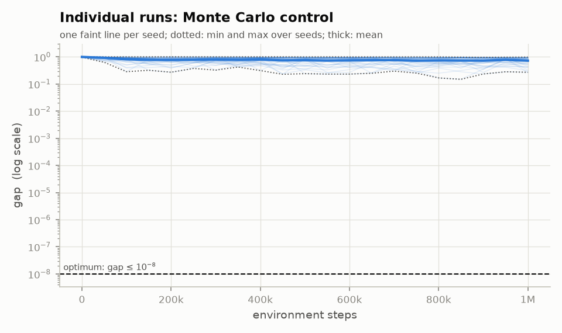
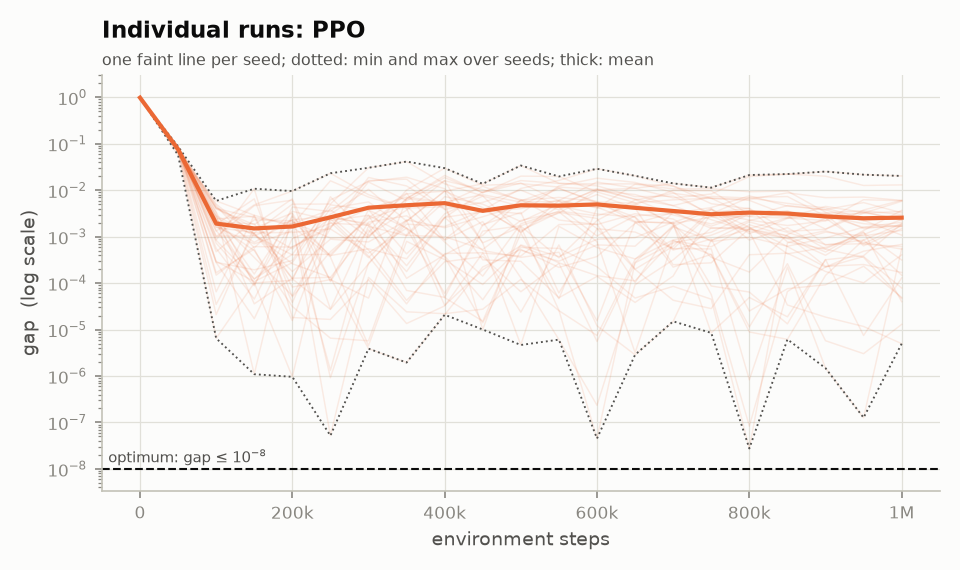

# reinforcement-learning-exposition

Compare reinforcement-learning algorithms on control problems with known optimal
costs. Run independent training seeds, measure how far each policy is from optimal,
and generate graphs and draft numerical-experiment reports.

The project includes tabular Monte Carlo control, neural and linear-Gaussian PPO,
and neural and structured TD-MPC2 variants. Experiments cover linear-quadratic
regulation (LQR) and nonlinear quadratic regulation (NLQR): nonlinear dynamics
with quadratic costs, constructed so the optimal value and policy are known.

## Quick start

From the repository root, with Python 3.12+ and [uv](https://docs.astral.sh/uv/):

```sh
uv sync --extra lq

# One Monte Carlo training seed on scalar LQR, with figures.
uv run main.py crude --algos monte_carlo --problem lqr \
  --seeds 1 --workers 1 \
  --set total_steps=10000 n_checkpoints=10
```

The command prints its output directory under `results/crude_<timestamp>_lqr/`.
Open `report/monte_carlo_runs.png` for the learning curve and `report/summary.md`
for the results. This small example demonstrates the workflow; use multiple seeds
and longer training to study performance.

## Compare all algorithms on bounded LQR

Run all five variants on the same bounded scalar LQR problem:

```sh
uv run --extra lq main.py matched-lq \
  --algos monte_carlo ppo-nn ppo-lg td-mpc2-nn td-mpc2-lg \
  --seeds 40 --steps 1000000 --checkpoints 20 \
  --workers 4 --master-seed 0 \
  --out results/all_algorithms
```

This is a substantial experiment: 200 million training interactions, plus
evaluation. For a smaller trial, use `--seeds 3 --steps 10000 --checkpoints 5`.
Choose a fresh output directory for each experiment.

Open `results/all_algorithms/benchmark_report/index.html` to browse the results.
To rebuild the report and compile its LaTeX draft:

```sh
uv run main.py report results/all_algorithms
bash scripts/build-latex.sh results/all_algorithms/benchmark_report/benchmark.tex
```

Compilation requires `latexmk` and a LaTeX installation; the PDF appears beside
`benchmark.tex`. See [running experiments](docs/usage.md) for the nonlinear suite
and [creating reports](docs/reports.md) for the complete reporting workflow.

## Run the nonlinear benchmark

The NLQR suite tests learning beyond linear dynamics while retaining an exact
optimal reference. This command runs ten generated nonlinear problems plus one
scalar LQR reference, reporting each problem separately:

```sh
uv run main.py suite \
  --algos monte_carlo ppo-nn ppo-lg td-mpc2-nn \
  --count 10 --seeds 40 --steps 102400 --checkpoints 20 \
  --workers 4 --generator-seed 0 --master-seed 0 \
  --out results/nonlinear_suite
```

All four listed variants support this suite; structured `td-mpc2-lg` supports
only bounded scalar LQR. For a small trial, use
`--count 1 --seeds 2 --steps 4096 --checkpoints 4` and a fresh output directory.
The full command uses about 180 million training interactions, plus evaluation.

Open `results/nonlinear_suite/benchmark_report/index.html` for the results.
The same directory contains `benchmark.tex`, ready to compile with the build
command above. See the [experiment guide](docs/usage.md#generated-nonlinear-suite)
for problem generation and seed controls.

## What the graphs show

Lower gap means closer to optimal. Each faint line is one training seed; the thick
line is the mean across seeds. The dotted lines show the smallest and largest gaps.



Monte Carlo control: in this initial experiment, the mean remains far from optimal.



Linear-Gaussian PPO: individual runs vary, while the mean reaches a much smaller gap.

These are historical illustrations from the [first LQR experiment](notes/numerical-experiments/first-ppo-lqr-baseline/first-ppo-lqr-baseline-test.pdf):
40 seeds per algorithm, one million training steps per seed, discount 0.99, and
unbounded scalar LQR. The PPO figure uses the original linear-Gaussian implementation.
They are separate from the bounded five-algorithm experiment above.

## Guides

- [Running experiments](docs/usage.md): algorithms, problems, seeds, budgets, CPU/GPU, and saved data.
- [Reading the graphs](docs/reading-the-graphs.md): single runs, averages, uncertainty, and limiting arguments.
- [Creating reports](docs/reports.md): figures, HTML, LaTeX drafts, and historical experiments.
