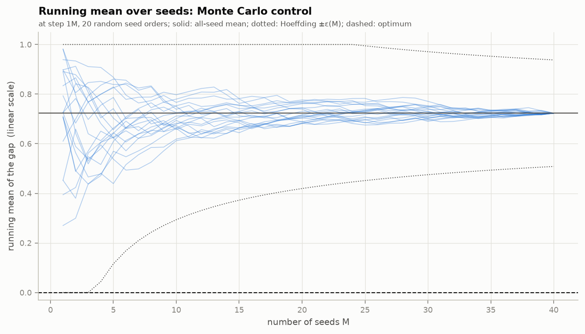

# Reading the graphs

[README](../README.md) · [Running experiments](usage.md) · [Creating reports](reports.md)

## What is being measured?

The learner sees states, actions, and rewards. The evaluator uses the known optimal
cost as a reference. At each training checkpoint, it evaluates the current
controller and reports the normalized cost gap:

$$g = 1 - J^*/J.$$

Here, `J` is the evaluated discounted cost and `J*` is the optimal cost from the
same initial state. Lower is better: zero is optimal, 0.1 means about 11% extra
cost, and 0.5 means twice the optimal cost. Infinite-cost or failed evaluations
receive gap one. Check failure and stability diagnostics as well as the mean.

PPO evaluation uses the deterministic mean controller, while training samples
Gaussian actions. Monte Carlo evaluation uses its greedy table policy. Structured
TD-MPC2 retains planner randomness and uses fixed evaluation streams; those streams
are not additional independent training seeds. Evaluation details are saved with
the run and may differ between problem families.

## One run, then many runs

A single-run learning curve follows one trained agent over environment steps.
Read it from left to right: the policy changes through training, and its evaluated
gap can rise as well as fall. The quick-start Monte Carlo command produces this
view with one seed. The suite report's `single_seed.png` selects the smallest
saved seed identifier per algorithm, independently of performance.

Repeating training with different random seeds produces different curves. The
`seeds_and_mean.png` benchmark figure shows every seed faintly and the mean boldly.
The two historical figures in the [README](../README.md#what-the-graphs-show)
show the same idea, with dotted minimum/maximum envelopes added.

At training step `N`, the average over `M` training seeds is:

$$\widehat g_M(N) = \frac{1}{M}\sum_{j=1}^{M} g_j(N).$$

Each seed has equal weight. This is the average of the individual gaps, rather
than the gap computed from an average cost. A low mean can coexist with poor
individual runs, so read the faint curves and the failure statistics too.

Historical README plots use a logarithmic gap axis: each major tick represents a
factor of ten. Their dashed optimum line is a plotting floor at `1e-8`, since
zero cannot appear on a log axis. Current benchmark plots use their own labeled
scale and consistent training-axis limits within a problem; inspect the ticks
before comparing visual distances.

## Two different limiting questions

**More training:** increase environment steps while following a fixed seed or
averaging a fixed collection of seeds. This asks whether the learning procedure
improves with experience. A plateau in a finite run does not establish a limiting
performance floor or prove convergence to the optimum.

**More seeds:** hold the training checkpoint fixed and average more independent
runs. This estimates the algorithm's expected gap at that checkpoint more
precisely. It does not train any individual policy further. Under independent,
identically distributed runs, bounded gaps satisfy the law of large numbers:
the seed average approaches the expected gap as the seed count increases.



This historical illustration fixes training at one million steps on unbounded
scalar LQR and adds the same 40 seeds in 20 different orders. The horizontal solid
line is the full-sample mean. Every ordering ends there because it contains the
same observations; the lines are not 20 new experiments or evidence that the true
expectation has been reached.

The dotted funnel uses Hoeffding half-widths centered on that final empirical
mean. Treat it as an illustration of the uncertainty scale, not a confidence
sequence for the entire running-average path. Current benchmark reports provide
`seed_averaging.png`, explicitly labeling the full-sample mean and the checkpoint.

## Uncertainty and interpretation

Individual-run spread measures variation between trained policies. Standard error
measures uncertainty in their estimated mean; it generally shrinks with more
independent seeds. Neither is a guarantee about the next trained policy.

The `crude`/fixed-run report includes Hoeffding bands for bounded gaps, with a
union bound across the specified training checkpoints. These can be wide for
small seed counts. To inspect how many seeds a chosen tolerance requires:

```sh
uv run main.py budget --eps 0.05 --delta 0.05 --checkpoints 20 --seeds 40
```

Here `eps` is an absolute gap tolerance and `delta` is the failure probability.
Use the actual number of evaluated checkpoints when budgeting, including the
initial checkpoint if present. The shared suite/matched report's mean-learning
curve figure does not itself draw confidence bands.

Compare algorithms within the same problem and evaluation setup. The generated
suite keeps problems separate because each has its own exact reference. A better
observed mean on one task is evidence about that configuration and budget; it does
not establish a universal algorithm ranking, convergence, or physical stability.
