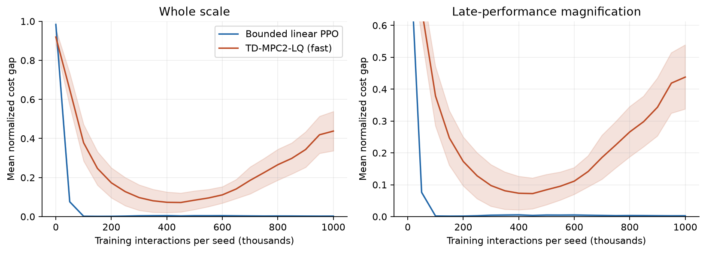
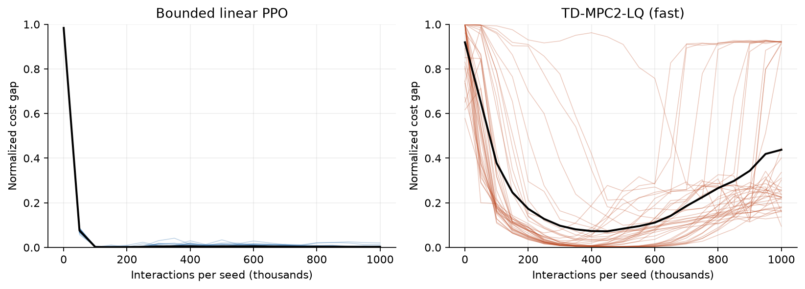
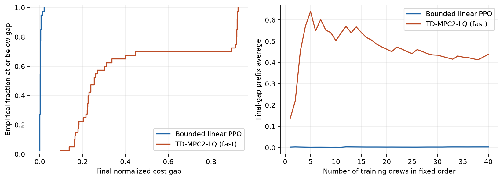
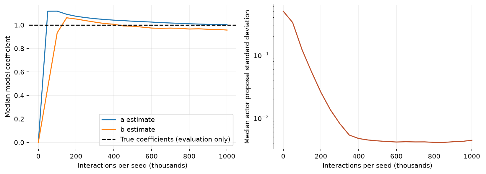
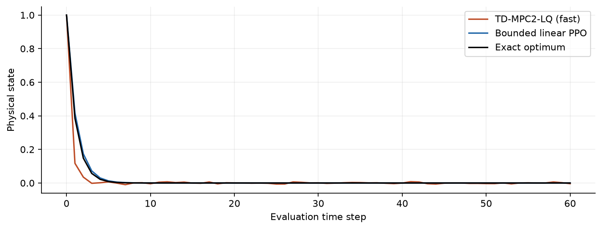

# Matched bounded PPO and TD-MPC2-LQ against the exact LQR optimum

Measured experiment, 23 November 2026. Prepared for Neil Dhawan and collaborators.

## Summary

Both methods completed **40 training seeds × 1,000,000 physical interactions**, with 21 checkpoints. PPO had the lower observed final mean normalized gap. PPO's mean was **0.002571** (sample SE 0.000601); TD-MPC2-LQ's was **0.437807** (SE 0.051365). Lower is better. The measured difference, TD minus PPO, was 0.435236. This is a comparison of two explicitly structured implementations on one scalar task, conditional on a fixed planner evaluation suite.

TD-MPC2-LQ improved to a mean gap of 0.072239 at 450,000 interactions and then deteriorated to 0.437807. More training did not reliably improve this untuned configuration. The experiment reveals a learning-quality problem to investigate; it does not establish its cause.

This is a fresh matched-action comparison using the initial PPO report's interaction budget, plant, optimum, checkpoint schedule and multi-seed approach. Both actuators now enforce [-2,2], as requested. The historical PPO numbers came from unbounded training and exact linear-policy evaluation; they are not used as the new comparator. TD-MPC2-LQ is the proposed fast adaptation, not standard neural TD-MPC2.

## Setup and exact reference

The environment is x_next=x+u, c=x²+u², x0=1 and gamma=.99. Reward is -c. The objective is the infinite discounted physical cost. The evaluator's discounted Riccati solution gives K*=0.615251245663 and J*=1.615251245663. The trajectory u*_t=-K*(1-K*)^t always satisfies |u|<2, so this optimum is also attainable under the shared bound from x0=1. It is not a claim that the constrained value function is globally quadratic.

Score each controller by g=1-J*/J. Zero is optimal, .5 means twice the optimal cost, and .1 means at most 1/.9≈1.111 times optimal cost. Average controller gaps across training seeds. For TD, first average costs across its three evaluation streams, then apply the gap transformation. Transforming the grand mean cost would give a different statistic.

The learner receives observed states, applied actions and costs. It knows its chosen linear/quadratic structural families, not the true coefficients or Riccati solution. Evaluation outcomes do not select updates, hyperparameters or stopping.

## Implementations and what is matched

PPO retains the original NumPy algorithm: linear Gaussian actor, value features [1,x,x²], eight environments, 250-step rollouts, ten epochs, four minibatches, lr=.0003, GAE=.95, ratio clip=.2, value weight=.5, entropy weight 0, gradient norm bound.5, initial gain 0 and std.5. The latent sample and its Gaussian log likelihood are stored; only the actuator clips the physical action. This preserves a coherent PPO likelihood for the latent policy. Deployment uses clip(-kx,-2,2). Its quadratic value approximator remains an approximation under saturation.

TD-MPC2-LQ has 16 online coefficients: two linear dynamics coefficients, four stage-cost coefficients, two four-coefficient cost critics, and actor gain/log-std. Stage-cost and critic features are [x²,2xu,u²,1]; the observation encoder is identity. Dynamics start at zero; cost/critics start at independent Normal(0,.01); actor gain 0/std.5. It learns joint three-step model consistency and cost/critic regression through predicted states. The target uses the maximum target cost critic; planning uses their mean. Actor gradients train a proposal prior, not a deployed substitute for the planner. It never solves LQR or a QP to select actions.

The fast configuration uses horizon 3, 64 candidates including eight actor-prior trajectories, three planner iterations, eight elites, replay batch 64, Adam lr=.0003, target tau=.01, temporal loss weight.5, joint loss weights 20/.1/.1, gradient norm bound 20 and latent proposal entropy weight.0001. Proposal std is restricted to [.05,2] during planning. Elite weights are proportional to exp[-.5(score-min score)]. Deployment samples an elite, executes its first action and replans with a shifted warm start. Training adds exploration noise; evaluation removes that extra perturbation but retains planner randomness.

Collection starts with 2,500 uniform random actions, followed by 157 learner updates. It subsequently updates every 16 interactions; the final total is 62,500 updates per seed. All available transitions are retained, and sampled three-transition sequences never cross 500-step physical resets. Time limits bootstrap. Actor loss uses H+1 detached predicted states; model/critic losses use H stages and two-critic averaging. The clipped actor's entropy bonus refers to its **latent Gaussian**, not the clipped action distribution. All planning coordinates are physical. These choices are explicit adaptations beyond replacing neural networks.

The shared interaction budget does not equalize gradient steps, reset schedules, exploration or inference work. PPO resets its eight collection environments every 250 steps, whereas TD uses500-step episodes. This preserves their declared collection setups but is a possible contributor to differences in data distribution. Squared scalar regression, reduced search and sparse updates prevent attributing the outcome purely to linearization or model-based learning.

## Certified infinite-horizon evaluation

Each checkpoint is scored from x0=1. TD uses the same three planner streams 910000/910001/910002 for every trained controller, with an initially zero warm start. PPO's deployed clipped mean is deterministic. Evaluation uses separate RNGs and restores TD planner memory; it cannot perturb subsequent training.

If H actions have been simulated, |x_(H+j)|≤|x_H|+2j gives the omitted-cost envelope

    R_H = gamma^H [ (|x_H|²+4)/(1-gamma)
                    +4|x_H|gamma/(1-gamma)²
                    +4gamma(1+gamma)/(1-gamma)³ ].

Nonnegative costs then give J∈[J_H,J_H+R_H]. Stop when every R_H<1e-6 (safeguard 5000 actions). Average the TD cost bounds over the three paths and transform both endpoints monotonically into gap bounds. The reported gaps use the conservative upper endpoints. Largest observed gap interval widths were 6.17e-07 for PPO and 6.14e-07 for TD; they are negligible relative to the measured sample uncertainty. The analytical tail is pathwise valid for any future admissible actions, including randomized, memory-dependent planning. Float64 arithmetic is used; there is no directed-rounding certificate for all numerical error.

The score estimates performance conditional on this fixed three-stream suite. Forty training seeds do not turn three deployment streams into a precise expectation over arbitrary future planner randomness. It is valid to compare these frozen-suite controller scores; broader deployment claims need more independent evaluation streams.

## Final results

| Controller | Mean gap | Sample SE | Median | Observed range | g≤.1 | Numerical failures |
|---|---:|---:|---:|---:|---:|---:|
| Bounded linear PPO | 0.002571 | 0.000601 | 0.001701 | 0.000004–0.020291 | 40/40 | 0/40 |
| TD-MPC2-LQ fast | 0.437807 | 0.051365 | 0.254075 | 0.094813–0.925266 | 1/40 | 0/40 |

Mean physical costs were 1.619437 for PPO and 7.465516 for TD, against J*=1.615251. These are means of controller costs, not costs inferred by transforming the mean gaps. A nonfinite training run would be retained with a gap1 failure penalty, not replaced; the failure counts above identify whether that policy was invoked. A penalized failed run's fallback rollout cost must not be interpreted as its real controller cost.

The left panel shows the full gap scale; the right magnifies final performance. Shading is mean ±1.96 sample SE, clipped to [0,1], for descriptive comparison. It is neither a distribution-free band nor a simultaneous confidence band over checkpoints. TD's mean gap was 0.378276 at 100,000 interactions and 0.084190 at 500,000. Its lowest recorded mean was 0.072239 at 450,000 interactions, versus 0.437807 at the final budget. PPO's lowest recorded mean was 0.001505 at 150,000 interactions. These post-hoc minima describe learning dynamics; they do not replace the preselected final endpoint or establish performance under early stopping. Changes need not be monotone, and finite-budget flattening does not prove an asymptotic floor. PPO's initial gap near one is expected: gain 0 holds x=1, costing 100 and giving g≈.98385.

Each colored line is one trained controller, and the black line is the mean. This distinguishes typical learning from variation or isolated poor runs. These 40 trajectories describe the sampled training draws; even empirical separation does not identify the support over all possible seeds.

The final empirical CDF shows how many controllers achieve each gap. The prefix plot adds seeds in their fixed draw order; it illustrates stabilization of the estimated mean, not further learning and not a proof of a law-of-large-numbers limit from 40 samples. Neither panel establishes closed-loop stability.

## Uncertainty and the strength of the ranking

The final paired difference was 0.435236, with descriptive paired SE 0.051358. TD's gap exceeded PPO's for 40/40 paired training identifiers. The approximate paired percentile-bootstrap 95% interval was [0.338783, 0.537654], using 50,000 resamples, bootstrap seed 20261123, and the full training controller as the sampling unit. This interval relies on bootstrap approximation and is conditional on the evaluation suite.

A separate conservative without-replacement Hoeffding 95% interval for the final population mean difference is [0.005765, 0.864708]. Scores differ within [-1,1], giving half-width sqrt(2 log 40/40)=0.429469, plus negligible tail allowance. The finite population is the 2^32 seed space; the correction for 40 sampled identifiers is negligible. This bound is distribution-free and much wider than the bootstrap interval. It excludes zero in the direction of the observed ranking.

The final checkpoint was the declared primary endpoint. No claims of simultaneous significance across 21 checkpoints are made. Pairing fixes the same training identifiers, not identical internal random draws or identical trajectories.

## Diagnostic evidence and the compute ablation

The final median learned dynamics coefficients were a=1.003573, b=0.956956; the true values1 are shown for evaluation only. Median actor proposal std was 0.00442504. These diagnostics show what the learner fitted and how its proposal spread changed. Model coefficients near1 are not sufficient for optimal control: stage-cost fitting, critics, actor proposals and stochastic search also influence the selected action. Parameter trends alone do not establish which mechanism caused a performance gap.

This is the first training draw and first primary evaluation stream, chosen by order rather than by return. It shows physical state over the first 60 evaluation actions against PPO and the exact optimum. It is an illustration, not an additional independent experiment or a global stability certificate. A weighted effective gain is saved as a descriptive statistic but never substitutes for rollout cost.

The separate four-seed, 10,000-interaction compute ablation gave mean gaps 0.785036 for fast TD-MPC2-LQ and 0.134188 for its structure-only reference. They used 625 versus 10,000 learner updates per seed. The reference also changes candidates 64→512, elites 8→64, prior paths 8→24, iterations 3→6 and batch 64→256. This is a joint compute-setting ablation, not an isolation of any one cause, and it uses only four seeds at a much shorter budget. It demonstrates why the fast variant cannot stand in for every structured TD-MPC2 configuration. No settings were changed in response to these results.

## Runtime, checks and reproducibility

PPO took 62.56 seconds; the full TD run took 538.40 seconds including checkpoint evaluation, saved outputs and process coordination. TD used four independent worker processes, ten seeds each, on a Windows host exposing 16 logical CPUs; training and planning used CPU float64, with a compiled Numba planner. There were 39.9 million training planner calls after random warmup. Each evaluates 576 candidate transitions plus 24 actor-proposal transitions, totaling 23.94 billion scalar model transitions for training action selection, excluding learner and evaluation rollouts. TD performed 2.5 million joint learner updates across 40 seeds (with separate model and actor Adam steps), versus 800,000 PPO minibatch optimizer steps. These are operation counts, not interchangeable units of compute. The separate 40-seed 100,000-interaction throughput run took 147.30 seconds in a serial batch. Some runs overlapped, so these wall times are practical execution measurements rather than controlled hardware speed benchmarks. JIT cache warmup and software state can affect repeats. Do not extrapolate a neural TD-MPC2 speedup ratio from these different algorithms and budgets.

Before the comparison, 68 tests passed, including every new model/actor gradient against finite differences, known-quadratic planning, compiled/Python agreement, replay alignment, target updates, batching invariance, evaluation RNG/memory restoration, and certified evaluation against exact reference controllers. A separate serial-versus-parallel check at 4,000 steps produced bit-identical saved learner and optimizer states. The final expanded suite passed 69 tests, including a check that bounded PPO applies clipped actions while retaining latent samples for its likelihood. These checks validate implementation properties, not scientific generalization.

Each method has 40 million primary training interactions. There are 21 weight snapshots per method, source/configuration manifests, per-seed metrics and preserved raw outputs under `results/lq_comparison/`. TD also retains per-worker snapshots, failure records and final RNG states. Checkpoints permit rescoring but omit replay, so exact training resumption requires rerunning. The isolated measured environment uses Python 3.12, NumPy 2.3.5, SciPy 1.18.1, Numba 0.68.1 and Matplotlib 3.11.2; direct requirements and commands are in `experiments/lq-comparison-README.md`. The experiment is locally protocolled, not externally preregistered.

## Significance for the research project

1. **The full comparison is now computationally feasible.** The structural implementation completed the original 40-seed, million-interaction allocation. Compute reduction is a measured engineering result for this implementation, not a guarantee for neural TD-MPC2.
2. **The measured performance belongs to the named variants.** PPO achieved the lower final sample mean on this bounded scalar task. The table and uncertainty section specify how strong that observation is. This does not rank standard PPO and standard TD-MPC2 across control tasks.
3. **Equal sample budgets expose different learning procedures.** On-policy PPO and replay-based model/critic learning use samples differently. The small ablation shows that reducing update and search effort can materially change the early outcome, so the fast settings require their own label.
4. **The exact optimum makes shortfall interpretable.** Success is proximity to the real attainable optimum, not merely beating another method. Lower gap does not prove robustness, convergence or physical stability.
5. **The next defensible study should separate the confounds.** Vary update frequency and search effort independently with held-out seeds; expand deployment evaluation streams; then extend to richer LQR/LQI systems before nonlinear claims. The present result is a reproducible preliminary experiment, not by itself a publication-level algorithmic contribution.

## Sources and provenance

The experimental basis is the repository PPO report/source at main snapshot a193ef9, the project's `tdmpc2-lq-design.md` and committed `notes/lq-adaptation/LQ adaptation.tex`, and the locally inspected official TD-MPC2 source at 332f19e4aba4bffe2dc736f45ea7f7bdc585903a. Current branch base is b3bd43e. The new runner's manifests store SHA-256 hashes and source copies. All numbers above are generated from the completed new runs, with the historical PPO report kept separate. No Monte Carlo rerun is included in this PPO-versus-TD allocation.
